# HydroCS 整合版 · 智能灌溉工作台

把「卫星影像 → 田块识别 → 手工修正 → 面积 → 作物生育期 → 灌溉需水量」串成一条手机能用的链路。

- **前端**：移动优先 H5 / PWA（React 18 + TypeScript + Vite + Tailwind v4 + MapLibre GL）
- **后端**：FastAPI（Python 3.12），跑 YOLO11s-seg 分割，并用**训练好的 ET 预测模型**（30 天 ERA5 窗口 → 日蒸散）解算需水量，SQLite 存田块与记录
- **算力**：识别引擎自动挑选后端 —— 有 CUDA 就用 CUDA（比 CPU 快 **7.8×**），没有就把模型转译成 ONNX 交给 DirectML / CPU（详见 [docs/performance.md](docs/performance.md)）
- **离线**：IndexedDB 缓存我的田块与历史，断网可查可编辑，联网按 op_id 幂等同步

```
        手机 H5 / PWA（离线优先）                       服务器（FastAPI）
┌────────────────────────────────────┐        ┌────────────────────────────────────────┐
│ MapLibre GL  卫星底图 + 田块 GeoJSON │        │ /imagery   瓦片代理·磁盘缓存·多源        │
│ 顶点编辑（触摸友好）                 │        │ /segment   滑窗 YOLO11s-seg → 多边形     │
│ IndexedDB    田块/记录副本           │ HTTPS  │ /irrigation ET 模型 × Kc → 需水量        │
│ 同步队列      离线编辑 → 增量合并     │<──────>│ /fields    田块权威存储（备份）           │
└────────────────────────────────────┘        │ /auth /sync /admin                      │
                                              │ SQLite(WAL) → 可平滑迁 PostgreSQL/PostGIS│
                                              └────────────────────────────────────────┘
```

---

## 0. 界面速览

| 工作台（桌面：左工具栏 / 中地图 / 下次级表 / 右详情） | 点「识别」后的候选田块 |
|---|---|
| 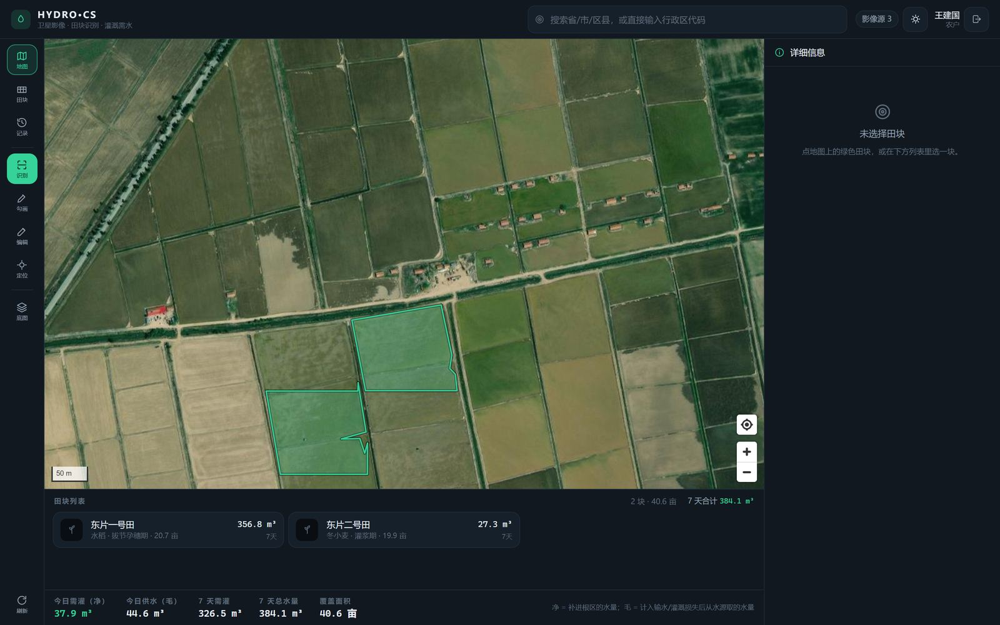 | 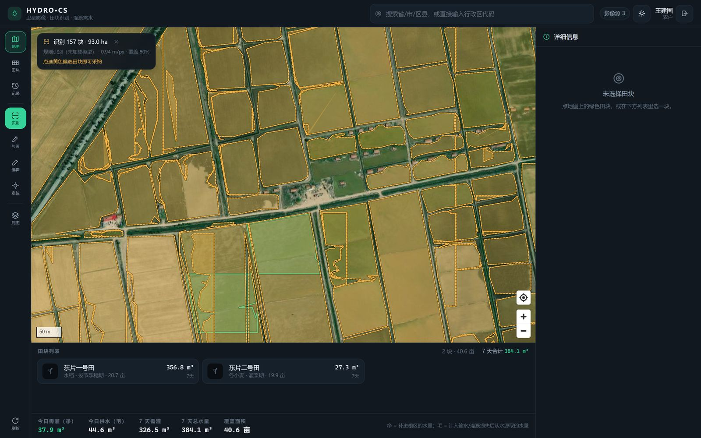 |

| 田块详情与需水解算 | 手机竖屏工作台 | 手机详情抽屉 |
|---|---|---|
| 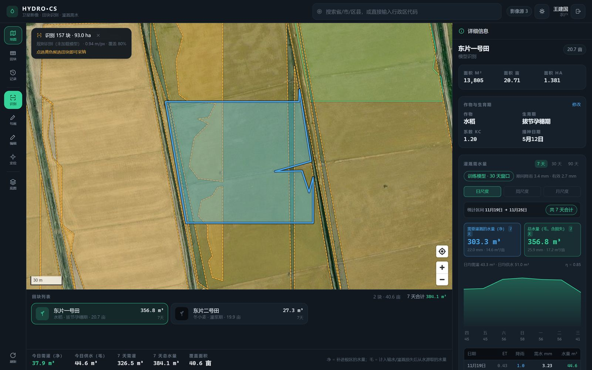 | 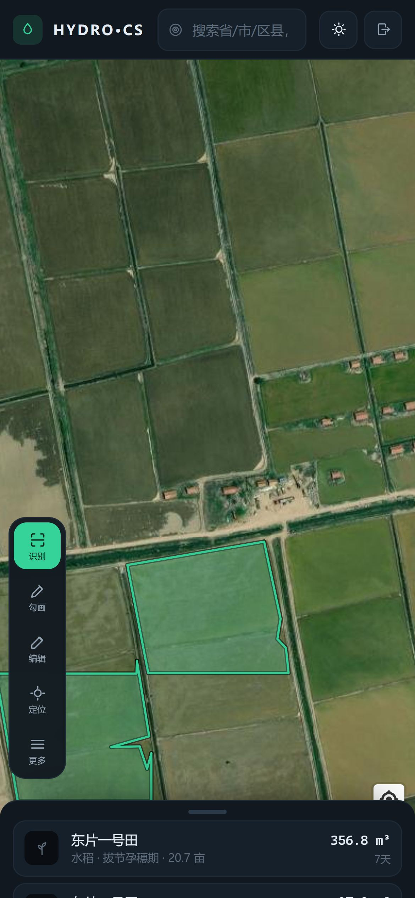 | 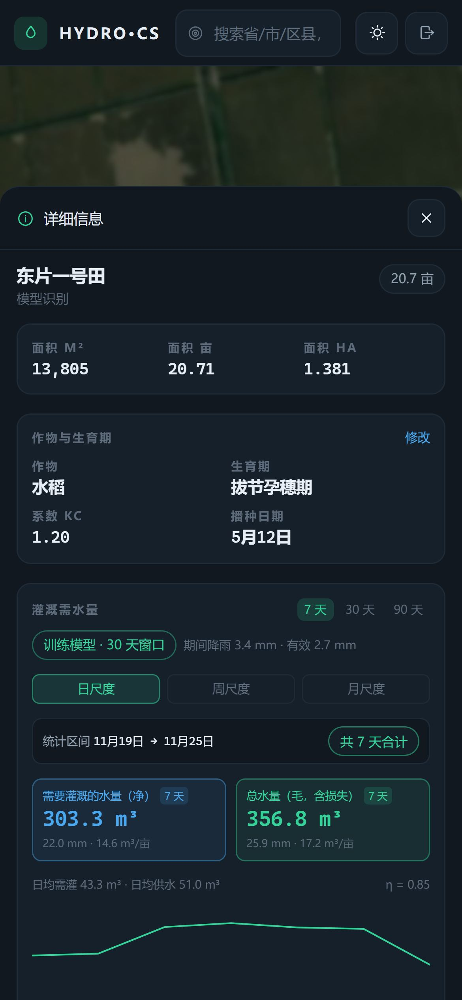 |

| 管理后台 | 断网后（应用外壳 + IndexedDB 副本） |
|---|---|
| 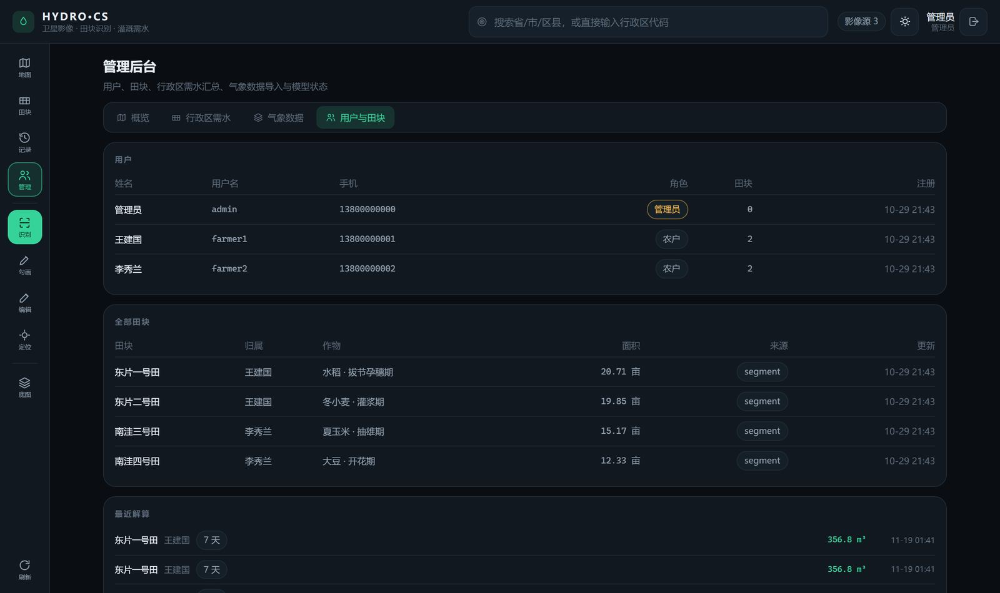 | 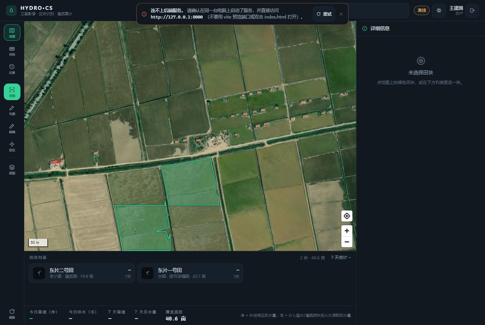 |

| 行政区模糊搜索 | 搜索后跳转（影像已预热，不再是白屏） |
|---|---|
| 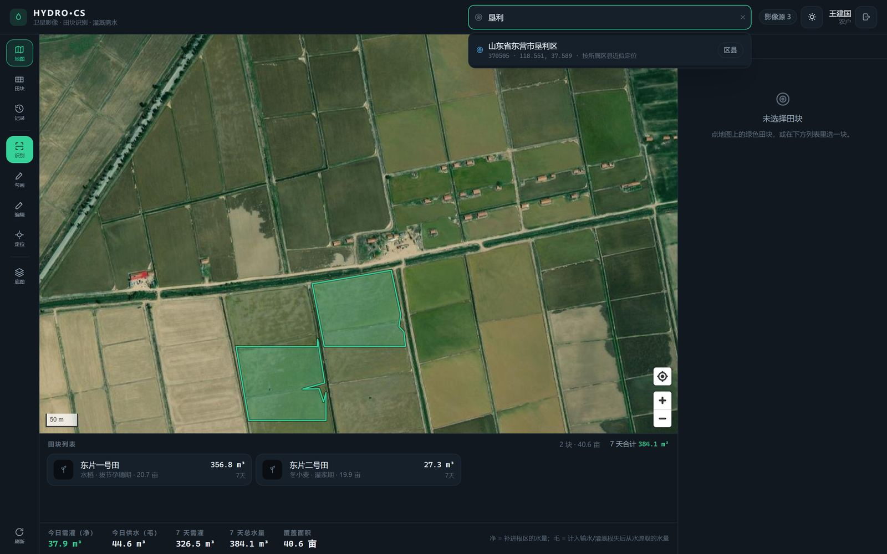 | 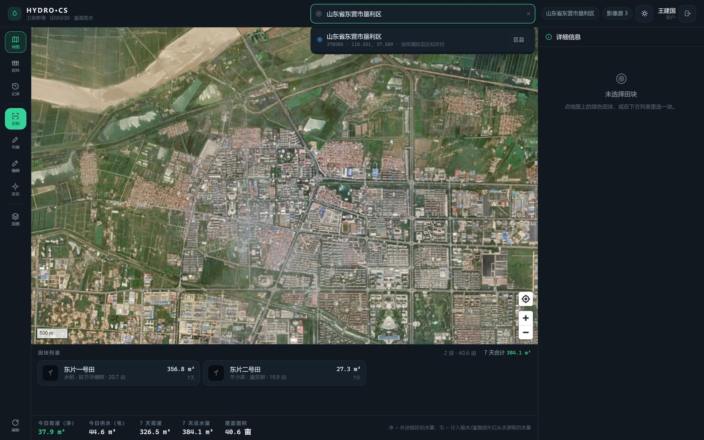 |

| 勾画时编辑面板停靠在左侧，不挡地图 | 行政区需水汇总 |
|---|---|
| 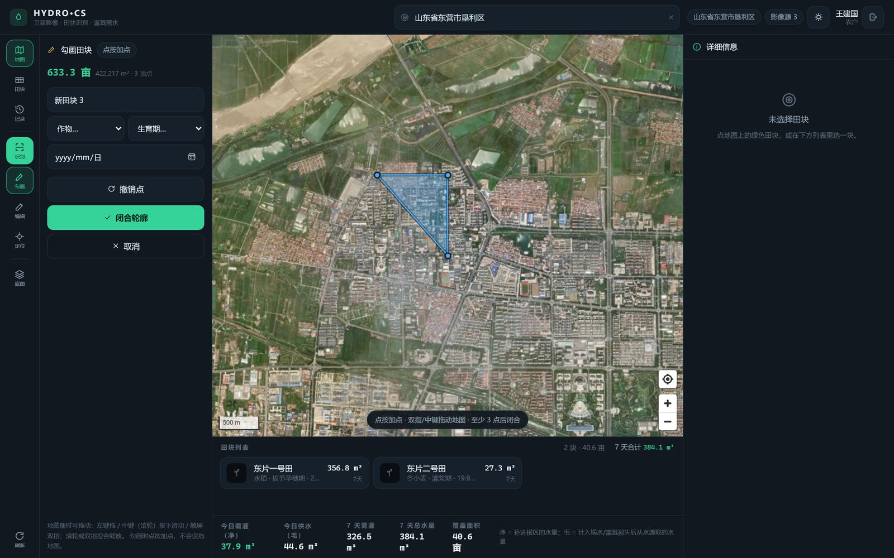 |  |

| 气象数据导入（上传 / 服务器目录） | 服务器目录浏览 |
|---|---|
|  |  |

| 村镇级搜索 | 周尺度累计需水 | 月尺度累计需水 |
|---|---|---|
| 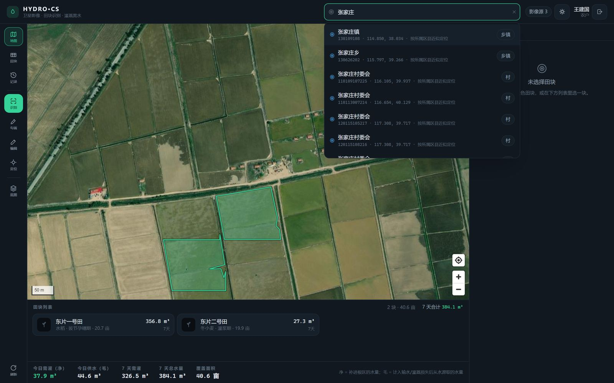 | 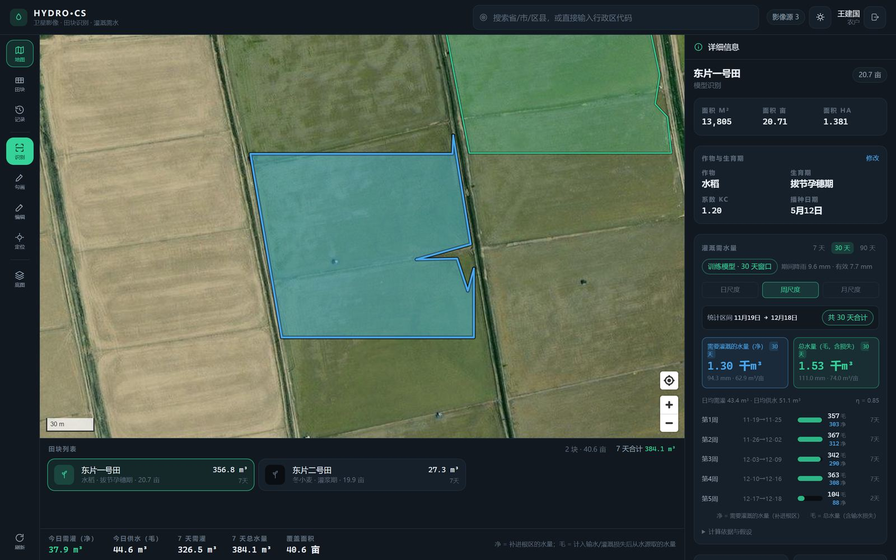 |  |

| 服务状态与 ET 预测模型（管理端） | 深缩放对齐（超出原生分辨率会提示） |
|---|---|
| 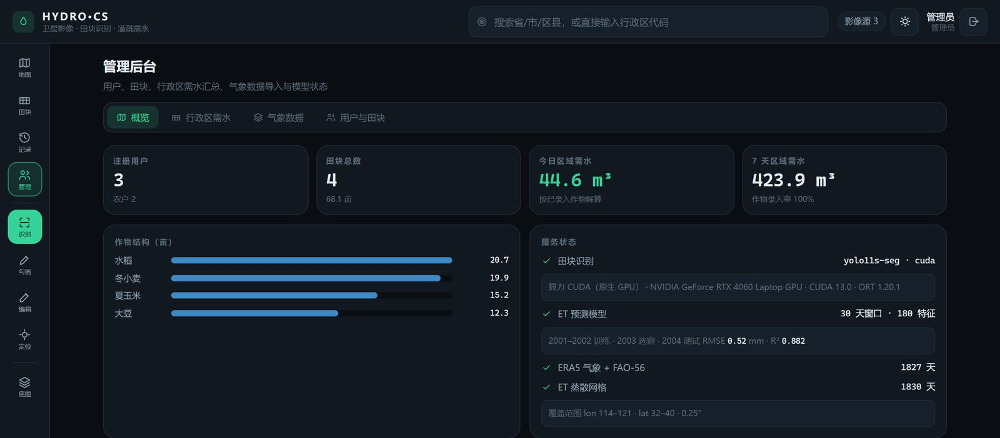 | 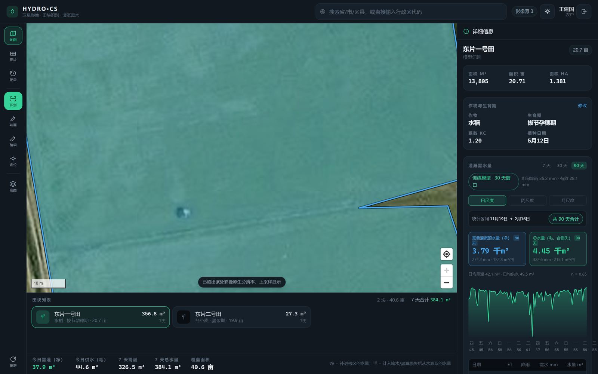 |

| 需灌水量（净）与总水量（毛）并列 | 我的田块：每块地的两个口径 |
|---|---|
| 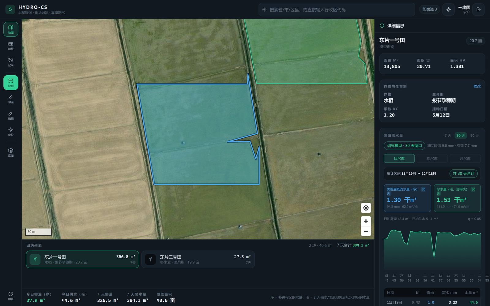 |  |

---

## 1. 这份代码用到的资产

| 资产 | 位置 | 本仓库怎么用 |
|---|---|---|
| YOLO11s-seg 农田分割权重 `4.102_best.pt`（20 MB，单类 farmland） | `../农田识别分割.rar` → `weights/` | 复制到 `server/artifacts/weights/`，由 `app/services/segmentation.py` 加载 |
| ETMonitor 日蒸散 0.25° 网格（2000–2004，1830 天 × 33 × 29） | `../2000-2004日尺度蒸散发数据集.rar` → `ERA5网格/` | `scripts/build_et_grid.py` 只抽取该目录（7.6 MB）并打包成 `et_grid.npz`（5.13 MB） |
| **ERA5 逐小时气象（2000–2004，20 个变量，1.4 GB）** | `../2000-2004 era5数据/` | `scripts/build_era5_daily.py` 读 8 个变量并算出 `et0`（Penman–Monteith）与 `pe`（有效降雨），打包成 `era5_daily.npz`（38.5 MB） |
| **训练好的日 ET 预测模型（0.78 MB）** | `../daily_et_window_study_code_20261016(1).zip` 的建模思路，用本仓库 ERA5 + ETMonitor 重训 | `scripts/train_et_model.py`：HistGradientBoosting，30 天窗口 × 6 变量 = 180 特征，2001–02 训练 / 2003 选窗 / 2004 测试，产出 `artifacts/models/et_model.joblib` |
| **中国行政区划边界** | DataV.GeoAtlas（省/市边界）+ `modood/Administrative-divisions-of-China`（乡镇/村名册，同一套国标 adcode） | `scripts/build_admin_divisions.py`：省/市多边形 + 2728 区县中心点 + 3.2 万乡镇 + 49.9 万村，共约 23 MB |

> 需水量**主路径走训练模型**：`Kc(作物, 生育期) / Kc(参考作物) × ET_模型 − 有效降雨`。
> ET_模型 由 ERA5 气象驱动、以 ETMonitor 日蒸散为标签，等价于把"物理公式 + 区域标定"换成学出来的映射；
> 模型资产缺失时才退回 FAO-56 Penman–Monteith（`era5-pm`），再无则退回 ETMonitor 近似（`etmonitor`）。
> 三条路径在响应里用 `method` 区分，界面直接显示当前用的是哪一条。

---

## 2. 目录

```
整合demo01/
├─ docs/architecture.md          架构、接口、算法规格（含验收标准）
├─ docs/performance.md           算力后端与并发的实测数据、部署配方
├─ server/
│  ├─ app/
│  │  ├─ main.py                 FastAPI 入口（/healthz、/docs、可选托管 SPA）
│  │  ├─ config.py               环境变量与路径
│  │  ├─ db.py                   SQLite（WAL）schema 与事务
│  │  ├─ repository.py           田块持久化与序列化
│  │  ├─ seed.py                 演示账号与 4 块示范田
│  │  ├─ routers/                auth · fields · segment · irrigation · imagery · sync · admin
│  │  └─ services/               geo（测地线/GCJ-02）· imagery · compute（算力探测）
│  │                             · seg_engine（CUDA/ONNX/DirectML 引擎）· segmentation
│  │                             · et_grid · era5 · et_model · irrigation
│  ├─ scripts/
│  │  ├─ build_et_grid.py        rar → et_grid.npz（自动调用 Bandizip 抽取）
│  │  ├─ build_era5_daily.py     逐小时 NC → 日尺度 + ET0 + Pe
│  │  ├─ train_et_model.py       日尺度特征窗 → ET 模型（joblib），输出验证/测试指标
│  │  ├─ export_onnx.py          .pt → .onnx（没有 CUDA 时的转译路径）
│  │  ├─ bench_segment.py        各推理后端单张延迟对比
│  │  ├─ bench_load.py           /segment 并发压测（吞吐、p50、分段耗时）
│  │  ├─ build_admin_divisions.py 省/市边界 + 区县中心点 → 搜索索引
│  │  ├─ smoke.py                端到端冒烟
│  │  └─ debug_segment.py        识别可视化调试
│  ├─ tests/test_core.py         41 个单元 + 接口测试
│  └─ artifacts/                 et_grid.npz、era5_daily.npz、models/et_model.joblib、weights/
└─ web/
   ├─ src/components/            MapCanvas · ToolRail · FieldSheet · DetailPanel · EditBar · IrrigationChart
   ├─ src/pages/                 Login · Workspace · MyFields · History · Admin
   ├─ src/store/                 auth · data · irrigation · ui · work（zustand）
   └─ src/lib/                   api · geo · idb · format · actions
```

---

## 3. 快速开始

```powershell
# ① 后端依赖
cd server
python -m pip install -r requirements.txt        # ultralytics / torch 体积较大，可先跳过用规则兜底

# ② 生成资产（一次性；ERA5 约 3 分钟，行政区需要联网约 2 分钟，训练约 1 分钟）
python scripts/build_et_grid.py
python scripts/build_era5_daily.py
python scripts/train_et_model.py
python scripts/build_admin_divisions.py

# ③ 放好分割权重（可选：没有权重会自动降级为规则识别）
copy ..\..\农田识别分割\weights\4.102_best.pt artifacts\weights\4.102_best.pt

# ④ 启动
python -m uvicorn app.main:app --host 127.0.0.1 --port 8000
```

> **算力可选加速**（都不改代码，启动时自动探测，顺序 `cuda → onnx-cuda → onnx-dml → torch-cpu → onnx-cpu`）：
>
> ```powershell
> # 有 NVIDIA 显卡：换 CUDA 版 torch，识别从 1.1 s 降到 145 ms
> python -m pip install --index-url https://download.pytorch.org/whl/cu130 torch==2.12.1+cu130 torchvision==0.27.1+cu130
>
> # 没有 CUDA（含 AMD/Intel 显卡）：把权重转译成 ONNX，走 DirectML
> python scripts/export_onnx.py
> python -m pip install onnxruntime-directml
> ```
>
> 实测与并发建议见 [docs/performance.md](docs/performance.md)：
> CUDA 145 ms / DirectML 453 ms / CPU 1130 ms（同一张 1024×1280 拼图、55 个地块），
> 单进程 7.1 req/s，2 进程 9.7 req/s；**进程内不要开并发**，横向扩展靠 `--workers`。

```powershell
# 前端（开发模式，Vite 代理 /api 到 8000）
cd web
npm install
npm run dev            # http://localhost:5173

# 或者只跑一个进程：先 build，后端会直接托管 web/dist
npm run build
# 然后访问 http://127.0.0.1:8000
```

演示账号：

| 用户名 | 密码 | 角色 | 说明 |
|---|---|---|---|
| `farmer1` | `123456` | 农户 | 王建国，2 块田（水稻 / 冬小麦） |
| `farmer2` | `123456` | 农户 | 李秀兰，2 块田（玉米 / 大豆） |
| `admin` | `admin123` | 管理员 | 区域汇总、用户与模型状态 |

演示坐标在**黄河三角洲**（`118.7996, 37.7994`，山东东营垦利）——这里地块方正、模型识别效果最好，且落在 ET 网格覆盖范围内。

---

## 4. 三条需求怎么落地的

### ① 程序栈与 C/S 分工

采用**服务端推理 + 离线优先客户端**：

- 服务端独占：影像抓取与缓存、YOLO 推理、多边形化、ET 网格解算、历史库、用户与审计。影像密钥不下发。
- 客户端独占：渲染、顶点编辑、面积实时预览、IndexedDB 本地副本、离线操作队列。
- 冲突处理：田块带 `rev` 乐观锁；同步时版本不符返回 409 并把服务端快照一并发给客户端，由用户裁决，不静默覆盖。

为什么模型不放手机：权重 20 MB + ET 多年数据，低端机推理 3–10 s 且耗电；密钥也不该出现在前端。

### ② 布局（左工具栏 / 中地图 / 下次级表 / 右详情）

| 断点 | 布局 |
|---|---|
| ≥1024 px | 左工具栏 64 px · 中地图 · 下次级表 196 px（含合计行） · 右详情 340 px |
| 768–1023 px | 左工具栏 · 中地图 · 详情改为下滑面板 |
| <768 px | 地图全屏；工具栏收为左侧悬浮竖排；次级表为底部三档吸附面板（92 px / 46dvh / 78dvh）；详情为覆盖抽屉 |

触摸规范：点击目标 ≥44 px，顶点手柄 11 px 视觉 + 24 px 命中区，底部用 `dvh` 避免地址栏跳动。

### ③ 高精度影像

| 源 | 分辨率 | 坐标系 | 密钥 | 状态 |
|---|---|---|---|---|
| `esri`（默认） | z19 ≈ 0.26 m/px（实测杭州城区），农区 z17–18 ≈ 0.4–0.8 m/px | WGS84 | 无 | ✅ 实测可达 |
| `amap` 高德卫星 | ≈0.5 m | GCJ-02 | 无 | ✅ 服务端做 GCJ-02→WGS84 归一 |
| `sentinel2`（EOX） | 10 m | WGS84 | 无 | ✅ 时序长势参考 |
| `tianditu` 天地图 | 0.5–1 m | WGS84 | 需 `TIANDITU_KEY` | ⚙️ 配 key 后自动启用 |

所有瓦片走 `/api/v1/imagery/tiles/{provider}/{z}/{x}/{y}` 代理：服务端落盘缓存 30 天、失败重试 + 备用主机、可整体换源。

---

## 5. 需要水量怎么算的

```
# 1) 数据侧：ERA5 逐小时 → 日尺度
Rn  = ssr + str                             # 净辐射 MJ/m²/d（累计值先按前一小时归日）
ET0 = [0.408Δ(Rn−G) + γ·900/(T+273)·u₂·VPD] / [Δ + γ(1+0.34u₂)]   # FAO-56，G≈0（仅作降级用）
Pe  = min(P × 0.8, 35)                      # 日有效降雨，上限 35 mm

# 2) 模型侧：30 天 ERA5 滑窗 → 当日 ET（主路径）
X        = [PRECIP, T2M, VPD, SSR, STR, U2M] × 最近 30 天 = 180 维
ET_model = HGB(X)                           # 目标 = ETMonitor 日蒸散，单位 mm/day

# 3) 田块侧：按与 0.25° 网格的面积重叠加权（不是取一个点）
ET_field  = Σ(wᵢ · ETᵢ) / Σwᵢ ；Pe_field 同理
ETc       = ET_field · Kc(作物, 生育期) / Kc_ref        # Kc_ref = 0.95（冬小麦中期）
净需水 In = max(0, ETc + 渗漏 − Pe_field)               # 水田渗漏按 3 mm/天
毛需水 Ig = In / η                                      # η = 0.85，固定
需灌水量 V_net   = In × A / 1000                        # m³/天，补进根区的水
总水量   V_gross = Ig × A / 1000                        # m³/天，从水源实际取的水
```

两个口径全部同时返回并展示：日序列、周/月滚存、区间合计都带
`net_volume_m3`（**需要灌溉的水量**）与 `gross_volume_m3`（**总水量**），
界面上用蓝色/绿色两张卡片并列，避免把"作物需要多少"和"水泵要抽多少"混为一谈。

- **为什么除以 Kc_ref 再乘 Kc**：ETMonitor 的 ET 是"参考作物（草）在该气候下实际消耗的水"，
  要给水稻/小麦/玉米换算，就按各自 Kc 与参考作物 Kc 的比值缩放，与 FAO-56 的 `ETc = Kc·ET0` 同构，
  但 ET0 这一环由数据驱动、含区域气候标定，比纯公式更贴地面观测。
- **模型指标**：2003 验证 RMSE **0.483** mm/day（R² 0.881）、2004 测试 RMSE **0.523** mm/day（MAE 0.360、R² 0.882），
  观测均值 1.88 mm/day，即在日均 1.9 mm 的量级上误差约 0.5 mm；窗口 1/7/30 天对比见 `artifacts/models` 元数据。
- **多时间尺度**：接口一次返回日序列 + `aggregates.weekly`（起始日起每 7 天滚动窗口）+ `aggregates.monthly`（自然月，首尾可为部分月）+ `cumulative` 累计；`days` 支持 1–180 天，前端在详情面板切换「日/周/月」。
- **预测（未来日期）**：ERA5 历史覆盖 2000–2004，超出该区间的日期（比如"今天"）取 2000–2004 年**同日序**的模型预测均值，
  即"模型学到的气候态"，响应里 `source` 标为 `model-climatology`，画面显示为「气候态外推」。
- **Pe 已接入**：由 ERA5 日降水估算，日上限 35 mm。
- **降级链**：`et_model.joblib` 缺失 → FAO-56 `ET0`（`method: era5-pm`）；`era5_daily.npz` 也缺失 → ETMonitor 近似（`method: etmonitor`）。
  每次响应都带 `method`、`et_basis` 与 `assumptions` 文本，界面直接展示当前用的哪一条。
- **域外降级**：坐标超出网格范围（lon 114–121 / lat 32–40）时退化为纬度-月序经验模型，并在响应里标 `extrapolated: true`。

面积一律用 WGS84 测地线公式（球面超额 + 曲率半径修正），实测与椭球真值偏差 <0.15%。

---

## 5.5 系数为什么固定、不再留给用户调

上一版把 `Kc_scale`、降雨利用系数、灌溉水利用系数做成了"按省/市继承、管理端可改"的参数层。
**这一版已整体下线**（`ParamPanel.tsx`、`/admin/params` 接口、`services/params.py` 均已删除），原因：

1. 这些系数本质是在替模型做区域标定；既然 ET 已由训练模型直接给出，再乘一个手调系数就是**双重标定**，容易把物理量调歪。
2. 可调参数没有留痕的验证集，改一个数谁也无法判断是变好还是变坏；而模型有 2003/2004 的独立验证与测试指标可追溯。

现在的口径是：**模型权重决定 ET，作物表决定 Kc，η 固定 0.85**。三个数都有出处、都能复算：

| 量 | 取值 | 出处 |
|---|---|---|
| `ET` | 模型输出（mm/day） | `artifacts/models/et_model.joblib`，2004 测试 RMSE 0.523 |
| `Kc` | 按作物 × 生育期查表（水稻 1.05–1.20、冬小麦 0.40–1.15、玉米 0.40–1.20、大豆 0.40–1.15） | `services/irrigation.py::CROPS`，FAO-56 表 11 |
| `Kc_ref` | 0.95 | 域内主导作物冬小麦的中期 Kc |
| `η` | 0.85 | 灌溉水利用系数（喷灌偏上、渠灌偏下），固定值 |
| `渗漏` | 3 mm/天（仅水田） | 常规淹灌田间渗漏量经验值 |
| `Pe` | `min(P × 0.8, 35)` | FAO-56 有效降雨简化式 |

调参入口若将来还要开，应该挂在"模型重新训练/区域重标定"这条链上，而不是让使用者在线改一个系数。

## 6. 识别流水线

```
bbox + zoom
 → 计算瓦片范围 → 并发下载（磁盘缓存 / 重试 / 备用主机）
 → 拼接大图（记录 WGS84 extent）
 → 滑窗推理：1024 px 窗口、128 px 重叠
 → 掩膜按置信度优先写入共享标签图（先到先得，消除相邻地块边界重复计数）
 → 轮廓 → 多边形简化（Douglas–Peucker 0.8% 周长）
 → 像素 → 经纬度 → 测地线面积 → 过滤 <0.01 ha / IoU>0.3 去重
 → GeoJSON（含 area_m2 / area_mu / area_ha / confidence）
```

降级链：`yolo` → `heuristic`（梯度+色彩均匀度+形态学，无需模型）→ 503 带原因。响应里始终有 `backend` 字段，前端据此提示。

---

## 7. 接口

`/docs` 是可交互的 OpenAPI 文档。摘要：

| 方法 | 路径 | 说明 |
|---|---|---|
| POST | `/api/v1/auth/login` \| `/register` | 登录 / 注册（JWT 7 天） |
| GET | `/api/v1/fields` | 我的田块（可按 bbox 过滤） |
| POST/PATCH/DELETE | `/api/v1/fields[/{id}]` | 新建 / 改属性或几何（带 `rev` 乐观锁） / 软删 |
| GET | `/api/v1/fields/{id}/irrigation?days=7` | 逐日需水曲线 + 假设说明 |
| GET | `/api/v1/irrigation/summary?days=7` | 全部田块汇总与逐日合计 |
| POST | `/api/v1/segment` | `{bbox, zoom, provider}` → 候选田块 GeoJSON |
| GET | `/api/v1/segment/status` | 当前识别后端与参数 |
| GET | `/api/v1/imagery/providers` \| `/tiles/...` \| `/warm` | 影像源 / 瓦片代理 / 定位前预热缓存 |
| GET | `/api/v1/geo/search?q=` | 行政区模糊搜索（省/市/区县 3238 条 + 乡镇 3.2 万 + 村 49.9 万，支持 adcode 前缀） |
| GET | `/api/v1/geo/locate?lat=&lon=` | 坐标反查省/市 |
| GET | `/api/v1/admin/regions/overview` | 有田块的行政区及其需水汇总 |
| GET | `/api/v1/admin/regions/summary?code=&days=7` | 某行政区整体需水 + 用水户统计 + 下辖分解 |
| GET | `/api/v1/admin/meteo/status` \| `/fs?path=` | 气象立方状态 / 服务器目录浏览 |
| POST | `/api/v1/admin/meteo/upload` \| `/scan` \| `/rebuild` | 上传 NC / 扫描服务器目录 / 按收件箱重建 |
| POST | `/api/v1/sync` | 批量推送离线操作（op_id 幂等） |
| GET | `/api/v1/admin/stats` \| `/users` \| `/fields` | 管理端（`stats` 内含 `et_model` 指标） |

---

## 8. 行政区划与气象数据运维

**行政区划**：服务端内置省/市边界（简化容差 0.01°，边界附近约 1 km 误差）、2728 个区县中心点，
以及 **3.2 万乡镇 + 49.9 万村** 的名称索引（已剔除城市「街道/办事处」）。
`/geo/search` 支持名称、全称、adcode 前缀与子序列模糊匹配，`垦利` / `3705` / `黄河口` / `张家庄` 都能命中；
乡镇与村没有内置坐标，命中后定位到**所属区县中心**并在结果里标 `precision: district-center`，界面会提示需手动微调。
田块按**中心点落区**归入地级市，`/admin/regions/summary` 再据此汇总整体需水与用水户。

**气象数据导入**（管理端「气象数据」页）：

| 入口 | 说明 |
|---|---|
| 上传 `.nc` 文件 | 浏览器只能选文件、不能选文件夹；文件落到 `data/meteo_inbox/`，按年份配对 8 个变量 |
| 扫描服务器文件夹 | H5 无法选目录，所以由服务端列目录（`/admin/meteo/fs`）再扫描并复制进收件箱 |
| 重建立方 | 用收件箱现有文件重算，幂等：同一年重复导入只覆盖对应日期 |

导入是增量的：新增年份追加、已有日期覆盖，未涉及的日期保持原值；导入完成后自动清空进程内的
ERA5 缓存并重载。测试覆盖了「追加 + 覆盖」的合并语义。

## 9. 验证结果（本机实测）

| 项目 | 结果 |
|---|---|
| 后端单测 + 接口测试 | `41 passed`（几何精度、FAO-56 复算、Kc 逻辑、周/月滚存、行政区检索与落区、瓦片象限裁切、气象合并语义、CRUD、越权、幂等同步、乐观锁冲突、算力探测与后端回退） |
| ET 模型训练 | 2001–2002 训练（15 万样本）· 2003 验证选窗 · 2004 测试；1/7/30 天窗对比后取 30 天 |
| ET 模型精度 | 2003 RMSE 0.483 mm/day（R² 0.881、MAE 0.335）；2004 RMSE 0.523 mm/day（R² 0.882、MAE 0.360），观测均值 1.88 mm/day |
| 模型优先链路 | `2004-07-15` → ET 4.326 mm（`source: model`）；`2026-10-30` → ET 0.854 mm（`source: model-climatology`）；`method` = `model-hgb` |
| 识别（默认演示视角，z18，0.54 m/px） | **156 个地块，合计 92.9 ha，覆盖画面 80%**（其余是道路、村舍、田埂） |
| 需水解算 | 演示田 20.7 亩水稻 7 天：需灌 303.3 m³（22.0 mm、亩均 14.7 m³）· 总水量 356.8 m³ |
| ET 网格资产 | 1830 天 × 33 × 29，有效像元 1,551,840，ET 0.00–14.78 mm/day |
| ERA5 日尺度资产 | 1827 天 × 33 × 29 × 8 变量（38.5 MB）；年均 ET0 2.40–2.70 mm/day、降水 1.86–3.02 mm/day |
| 需水接口耗时 | 单田块 7 天 ≈ 140 ms（含模型逐日推理）；两田块汇总 < 300 ms |
| 识别算力（同一张 1024×1280 拼图、55 个地块） | CUDA **145 ms** · DirectML **453 ms** · torch-CPU **1130 ms** · ONNX-CPU 1572 ms |
| 识别并发（单进程，推理闸门=1） | 并发 1/2/4 → p50 141/188/328 ms，吞吐 7.1/5.9/4.3 req/s |
| 识别横向扩展（多进程） | 1/2/3 进程 → 7.1/9.7/10.8 req/s（单卡 8.6 GB 约 3 进程饱和） |
| 识别缓存 | 同参数重复识别 ≈ 2 ms；拼图内存 LRU 命中 0 ms |
| 前端构建 | `tsc --noEmit` 通过；`vite build` 1.06 MB JS / 305 KB gzip |
| 浏览器巡检 | Playwright + Edge：桌面/手机双视口 + 搜索/勾画/行政区/气象/净毛/模型状态 共 20 张截图，**控制台 0 错误** |
| 行政区汇总 | 东营市 370500：6 块田 / 2 户 / 113.4 亩 / 7 天 933 m³ |
| 定位后影像 | 搜索「垦利」跳转后 `areTilesLoaded=true`，影像正常渲染 |
| 深缩放对齐 | 放大到 z19：`queryRenderedFeatures` 仍命中田块、边界与影像贴合；超出原生分辨率时提示上采样 |
| 村镇搜索 | `黄河口` → 黄河口镇（170 ms）；`张家庄` → 镇/乡/村委会共 8 条 |
| 模型状态可见 | 管理端概览显示「ET 预测模型 30 天窗口 · 180 特征」与「2001–2002 训练 · 2003 选窗 · 2004 测试 RMSE 0.52 mm · R² 0.882」 |
| 净/毛双口径 | 东片一号田 30 天：需灌 1.30 千m³（94.3 mm / 62.9 m³/亩）· 总水量 1.53 千m³（111.0 mm / 74.0 m³/亩），比值 = 1/η |
| 断网巡检 | 关网后刷新：应用外壳来自 SW 缓存，田块来自 IndexedDB，并显示「离线」标记 |

复现：

```powershell
cd server; python -m pytest tests -q
cd server; python scripts/smoke.py              # 登录→田块→需水→识别→管理端
cd server; python scripts/train_et_model.py     # 重训 ET 模型并打印验证/测试指标
cd server; python scripts/export_onnx.py        # 导出 ONNX（DirectML/CUDA EP 用）
cd server; python scripts/bench_segment.py      # 各推理后端延迟对比
cd server; python scripts/bench_load.py --concurrency 1,2,4   # 并发压测（需先启动服务）
cd server; python scripts/build_seed_fields.py  # 用识别结果重建演示田块
cd server; python scripts/debug_segment.py      # 生成 seg_debug.png 目视检查
cd web;    npm run build
cd web;    node scripts/verify.mjs              # 需先启动 8000 端口的服务
cd web;    node scripts/verify-offline.mjs
cd web;    node scripts/verify-netgross.mjs
cd web;    node scripts/verify-etmodel.mjs
```

---

## 10. 已知限制与下一步

1. **预测用气候态**：ERA5 只到 2004 年，超出该区间的日期（含"今天"）走「模型同日序 5 年气候态」。要真正预报，需接入实时 ERA5/预报场，接口层已按 provider 预留。
   - 行政区落区用的是简化边界（0.01°），紧贴边界的田块可能归错相邻市；需要精确时可把 `--tolerance` 调到 0.003 重建。
   - 乡镇/村只有名称索引、没有坐标，选中后定位到所属区县中心；要精确到村可接高德 POI（`AMAP_KEY`）。
2. **模型学的是"实际蒸散"而非"潜在需求"**：标签来自 ETMonitor 的水分限制型 ET，干旱年份土壤缺水会让实际 ET 低于潜在蒸散，此时模型可能**低估**灌溉需求；
   湿润年份则可能略高。若要校正，正确做法是用灌溉实验田块做一次区域偏差订正（MBE），而不是在前端乘系数。
   当前 2004 年 MBE = −0.151 mm/day（模型略偏低），可在 `train_et_model.py` 里加常数订正项重训。
3. **模型只覆盖 2000–2004 / lon 114–121 / lat 32–40**：范围内 848/957 格点有标签；域外或年份外走气候态外推并明确标注，不做跨气候区外推。
4. **识别只在影像可见的时段有效**：地块边界随作物季相变化，建议每个生长季刷一次。
5. **单机 SQLite**：田块量级到万级没问题；要多实例部署时把 `db.py` 换成 SQLAlchemy + PostGIS（几何字段已经是 GeoJSON + bbox，迁移成本低）。
6. **瓦片离线只做了 LRU 缓存**：Service Worker 会缓存最近 220 张影像瓦片，没提前预取整片农田；长期离线巡田需要再加「离线下载当前区域」按钮。
7. **多语言/适老化**：字号与对比度已按户外可读调过，但还没有大字模式与语音播报。
