# HydroCS 整合版 · 智能灌溉工作台

把「卫星影像 → 田块识别 → 手工修正 → 面积 → 作物生育期 → 灌溉需水量」串成一条手机能用的链路。

- **前端**：移动优先 H5 / PWA（React 18 + TypeScript + Vite + Tailwind v4 + MapLibre GL）
- **后端**：FastAPI（Python 3.12），跑 YOLO11s-seg 分割与蒸散网格解算，SQLite 存田块与记录
- **离线**：IndexedDB 缓存我的田块与历史，断网可查可编辑，联网按 op_id 幂等同步

```
        手机 H5 / PWA（离线优先）                       服务器（FastAPI）
┌────────────────────────────────────┐        ┌────────────────────────────────────────┐
│ MapLibre GL  卫星底图 + 田块 GeoJSON │        │ /imagery   瓦片代理·磁盘缓存·多源        │
│ 顶点编辑（触摸友好）                 │        │ /segment   滑窗 YOLO11s-seg → 多边形     │
│ IndexedDB    田块/记录副本           │ HTTPS  │ /irrigation ET 网格 × Kc → 需水量        │
│ 同步队列      离线编辑 → 增量合并     │<──────>│ /fields    田块权威存储（备份）           │
└────────────────────────────────────┘        │ /auth /sync /admin                      │
                                              │ SQLite(WAL) → 可平滑迁 PostgreSQL/PostGIS│
                                              └────────────────────────────────────────┘
```

---

## 0. 界面速览

| 工作台（桌面：左工具栏 / 中地图 / 下次级表 / 右详情） | 点「识别」后的候选田块 |
|---|---|
| 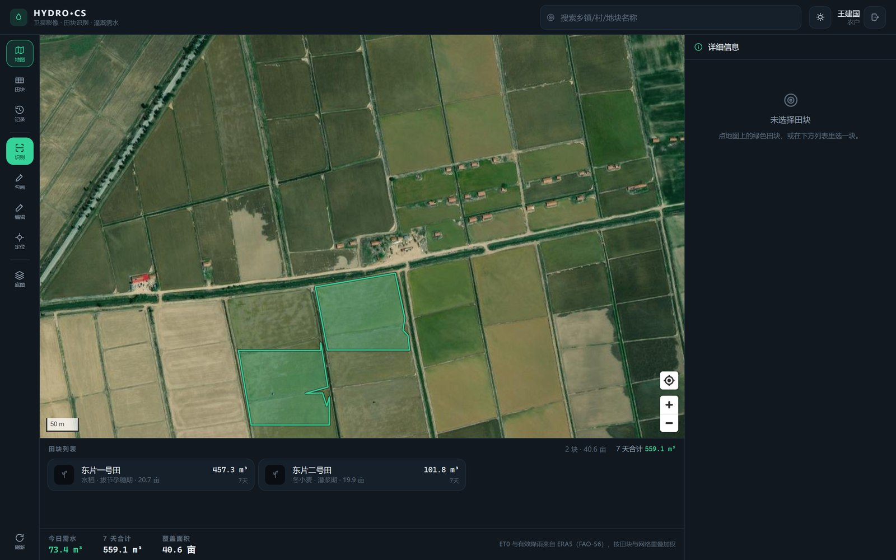 | 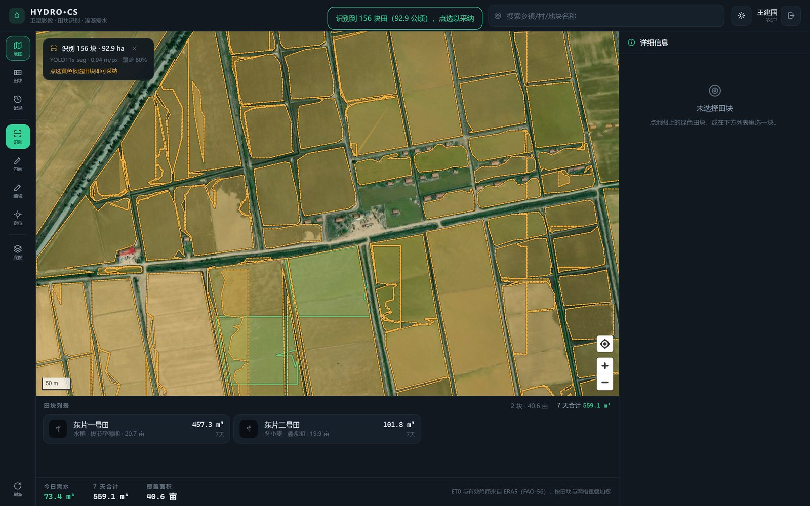 |

| 田块详情与需水解算 | 手机竖屏工作台 | 手机详情抽屉 |
|---|---|---|
| 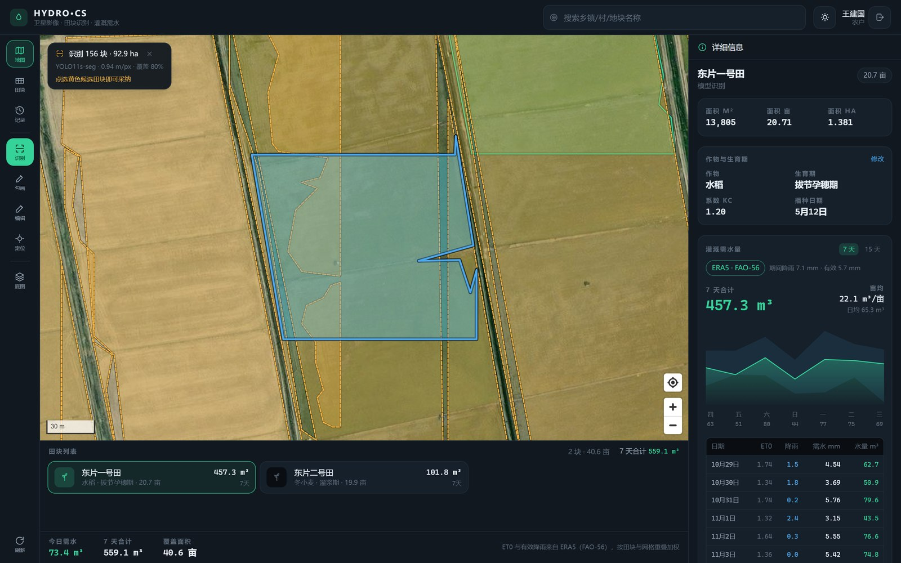 | 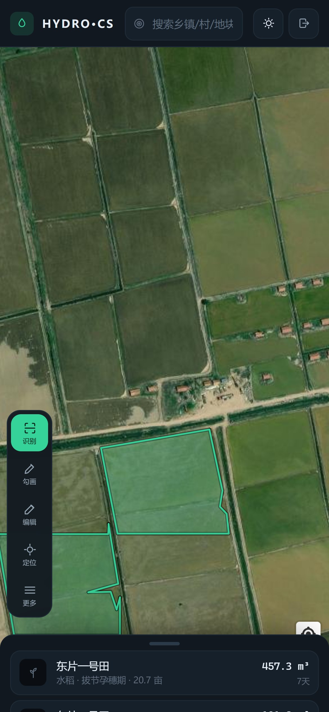 | 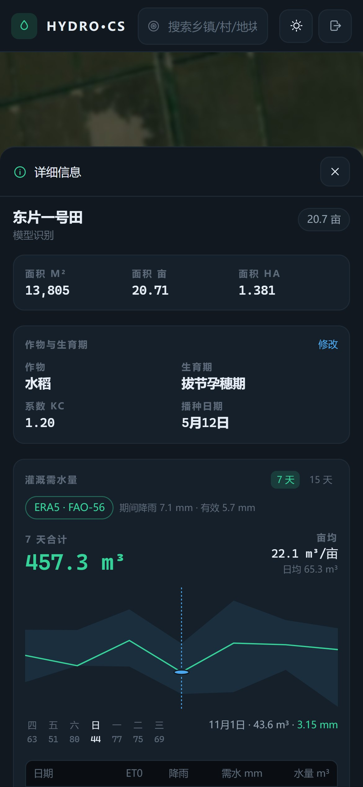 |

| 管理后台 | 断网后（应用外壳 + IndexedDB 副本） |
|---|---|
| 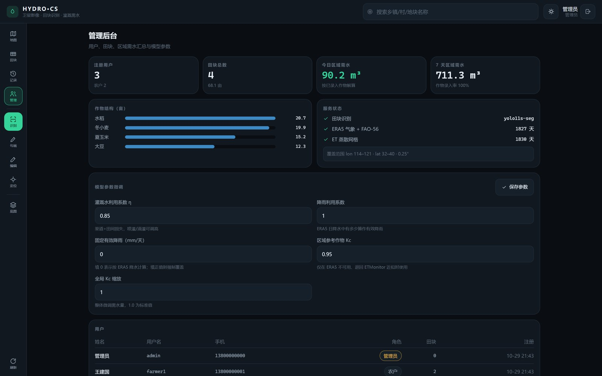 | 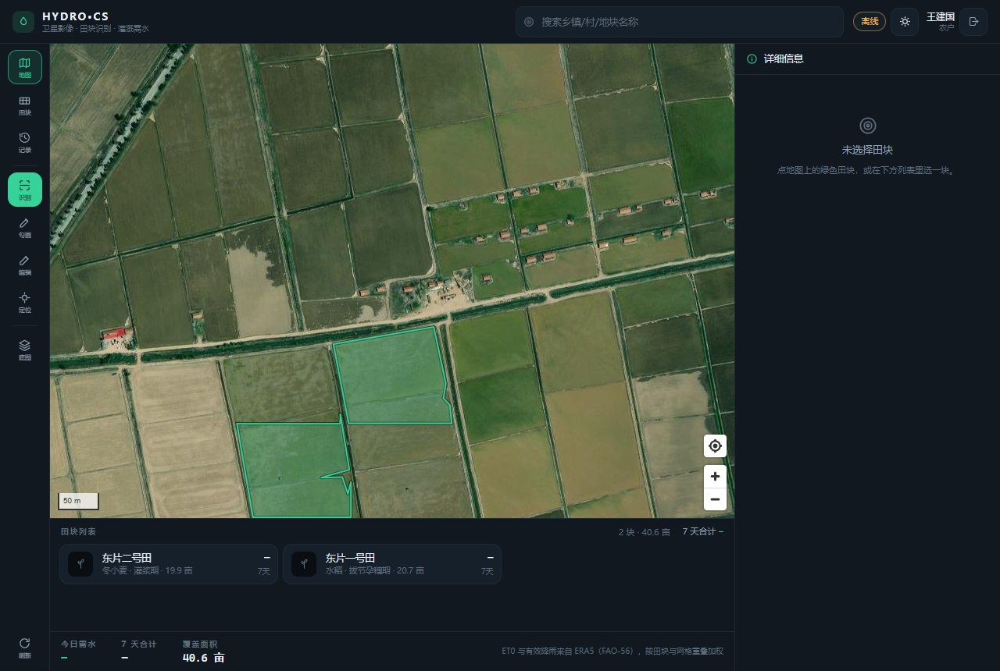 |

| 行政区模糊搜索 | 搜索后跳转（影像已预热，不再是白屏） |
|---|---|
| 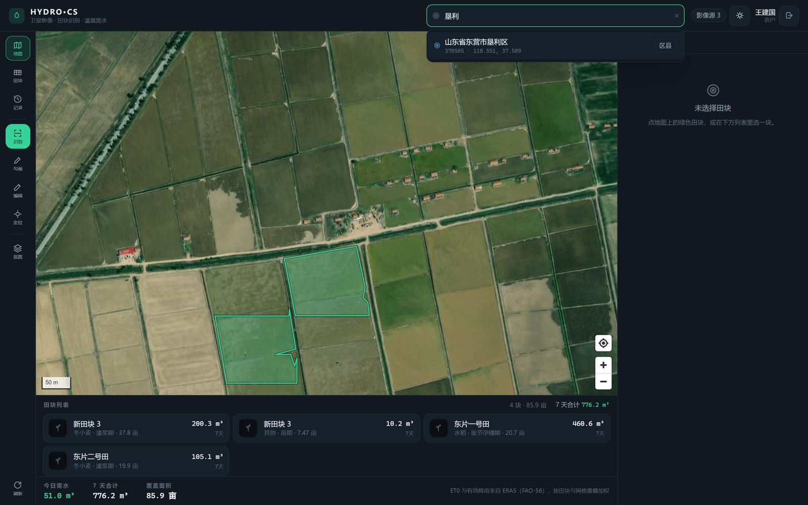 | 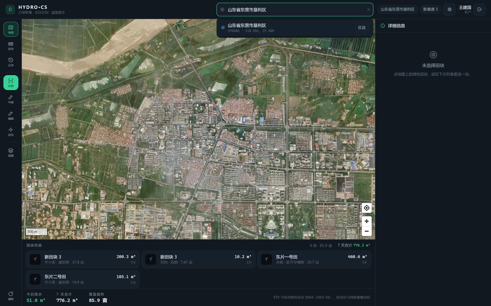 |

| 勾画时编辑面板停靠在左侧，不挡地图 | 行政区需水汇总 |
|---|---|
| 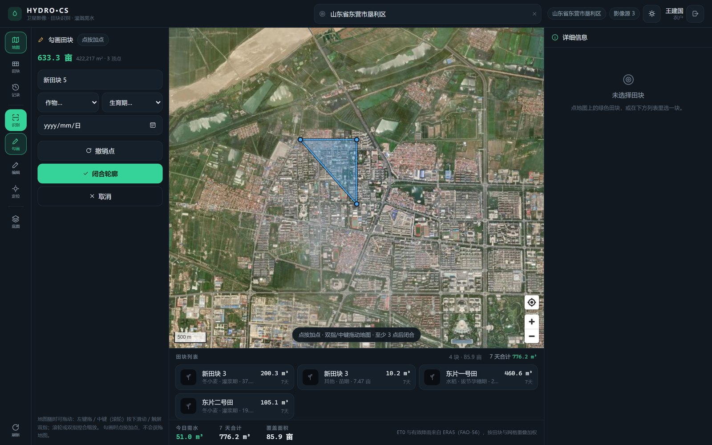 |  |

| 气象数据导入（上传 / 服务器目录） | 服务器目录浏览 |
|---|---|
|  |  |

| 村镇级搜索 | 周尺度累计需水 | 月尺度累计需水 |
|---|---|---|
| 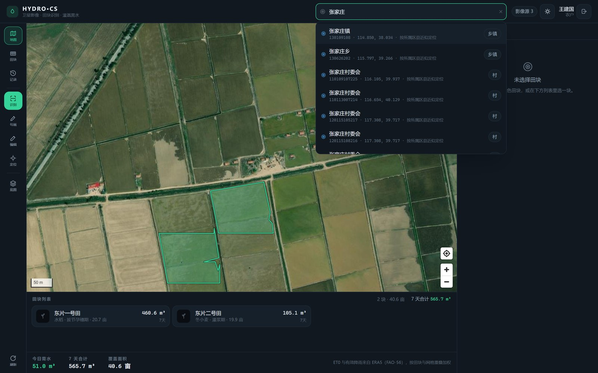 | 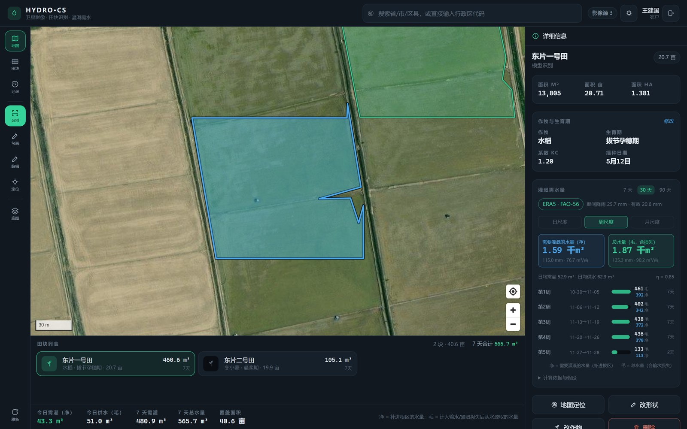 | 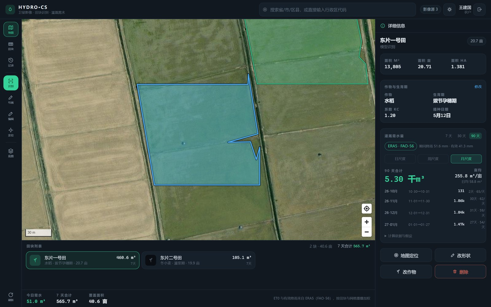 |

| 按行政区继承的模型系数 | 深缩放对齐（超出原生分辨率会提示） |
|---|---|
|  | 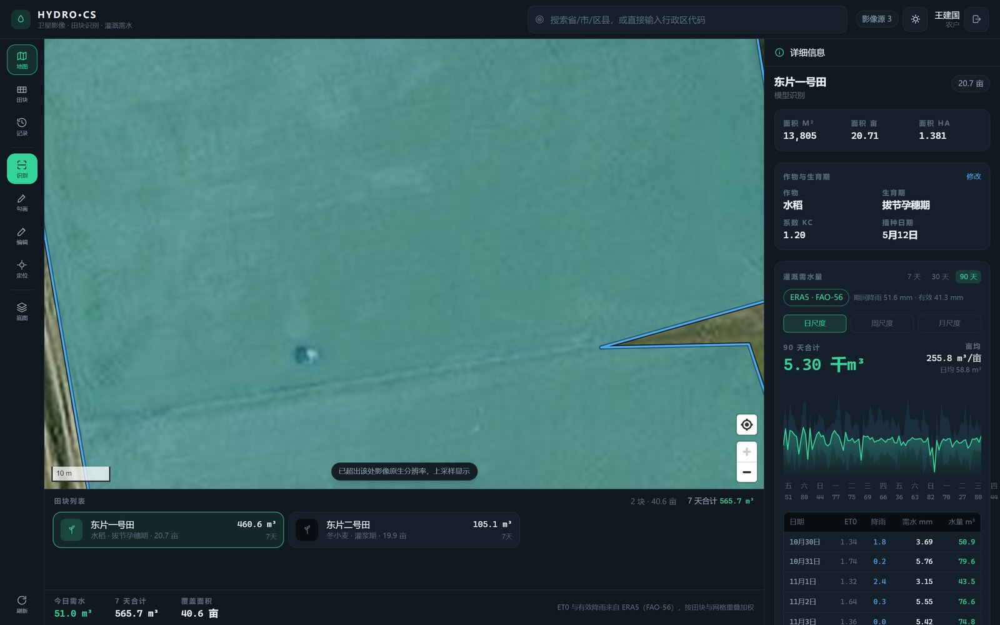 |

| 需灌水量（净）与总水量（毛）并列 | 我的田块：每块地的两个口径 |
|---|---|
| 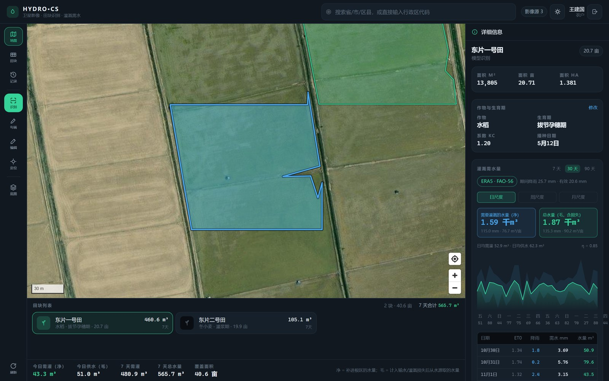 |  |

---

## 1. 这份代码用到的资产

| 资产 | 位置 | 本仓库怎么用 |
|---|---|---|
| YOLO11s-seg 农田分割权重 `4.102_best.pt`（20 MB，单类 farmland） | `../农田识别分割.rar` → `weights/` | 复制到 `server/artifacts/weights/`，由 `app/services/segmentation.py` 加载 |
| ETMonitor 日蒸散 0.25° 网格（2000–2004，1830 天 × 33 × 29） | `../2000-2004日尺度蒸散发数据集.rar` → `ERA5网格/` | `scripts/build_et_grid.py` 只抽取该目录（7.6 MB）并打包成 `et_grid.npz`（5.13 MB） |
| **ERA5 逐小时气象（2000–2004，20 个变量，1.4 GB）** | `../2000-2004 era5数据/` | `scripts/build_era5_daily.py` 读 8 个变量并算出 `et0`（Penman–Monteith）与 `pe`（有效降雨），打包成 `era5_daily.npz`（38.5 MB） |
| **中国行政区划边界** | DataV.GeoAtlas（省/市边界）+ `modood/Administrative-divisions-of-China`（乡镇/村名册，同一套国标 adcode） | `scripts/build_admin_divisions.py`：省/市多边形 + 2728 区县中心点 + 3.2 万乡镇 + 49.9 万村，共约 23 MB |

> 有了 ERA5，需水量走**教科书口径**：`Kc × ET0 − 有效降雨`。ETMonitor 网格保留为降级路径（ERA5 资产缺失时自动切换），不再参与主计算。

---

## 2. 目录

```
整合demo01/
├─ docs/architecture.md          架构、接口、算法规格（含验收标准）
├─ server/
│  ├─ app/
│  │  ├─ main.py                 FastAPI 入口（/healthz、/docs、可选托管 SPA）
│  │  ├─ config.py               环境变量与路径
│  │  ├─ db.py                   SQLite（WAL）schema 与事务
│  │  ├─ repository.py           田块持久化与序列化
│  │  ├─ seed.py                 演示账号与 4 块示范田
│  │  ├─ routers/                auth · fields · segment · irrigation · imagery · sync · admin
│  │  └─ services/               geo（测地线/GCJ-02）· imagery · segmentation · et_grid · irrigation
│  ├─ scripts/
│  │  ├─ build_et_grid.py        rar → et_grid.npz（自动调用 Bandizip 抽取）
│  │  ├─ build_era5_daily.py     逐小时 NC → 日尺度 + ET0 + Pe
│  │  ├─ build_admin_divisions.py 省/市边界 + 区县中心点 → 搜索索引
│  │  ├─ smoke.py                端到端冒烟
│  │  └─ debug_segment.py        识别可视化调试
│  ├─ tests/test_core.py         17 个单元 + 接口测试
│  └─ artifacts/                 et_grid.npz、weights/（gitignore）
└─ web/
   ├─ src/components/            MapCanvas · ToolRail · FieldSheet · DetailPanel · EditBar · IrrigationChart
   ├─ src/pages/                 Login · Workspace · MyFields · History · Admin
   ├─ src/store/                 auth · data · irrigation · ui · work（zustand）
   └─ src/lib/                   api · geo · idb · format · actions
```

---

## 3. 快速开始

```powershell
# ① 后端依赖
cd server
python -m pip install -r requirements.txt        # ultralytics / torch 体积较大，可先跳过用规则兜底

# ② 生成三份资产（一次性；ERA5 约 3 分钟，行政区需要联网约 2 分钟）
python scripts/build_et_grid.py
python scripts/build_era5_daily.py
python scripts/build_admin_divisions.py

# ③ 放好分割权重（可选：没有权重会自动降级为规则识别）
copy ..\..\农田识别分割\weights\4.102_best.pt artifacts\weights\4.102_best.pt

# ④ 启动
python -m uvicorn app.main:app --host 127.0.0.1 --port 8000
```

```powershell
# 前端（开发模式，Vite 代理 /api 到 8000）
cd web
npm install
npm run dev            # http://localhost:5173

# 或者只跑一个进程：先 build，后端会直接托管 web/dist
npm run build
# 然后访问 http://127.0.0.1:8000
```

演示账号：

| 用户名 | 密码 | 角色 | 说明 |
|---|---|---|---|
| `farmer1` | `123456` | 农户 | 王建国，2 块田（水稻 / 冬小麦） |
| `farmer2` | `123456` | 农户 | 李秀兰，2 块田（玉米 / 大豆） |
| `admin` | `admin123` | 管理员 | 区域汇总、用户与参数 |

演示坐标在**黄河三角洲**（`118.7996, 37.7994`，山东东营垦利）——这里地块方正、模型识别效果最好，且落在 ET 网格覆盖范围内。

---

## 4. 三条需求怎么落地的

### ① 程序栈与 C/S 分工

采用**服务端推理 + 离线优先客户端**：

- 服务端独占：影像抓取与缓存、YOLO 推理、多边形化、ET 网格解算、历史库、用户与审计。影像密钥不下发。
- 客户端独占：渲染、顶点编辑、面积实时预览、IndexedDB 本地副本、离线操作队列。
- 冲突处理：田块带 `rev` 乐观锁；同步时版本不符返回 409 并把服务端快照一并发给客户端，由用户裁决，不静默覆盖。

为什么模型不放手机：权重 20 MB + ET 多年数据，低端机推理 3–10 s 且耗电；密钥也不该出现在前端。

### ② 布局（左工具栏 / 中地图 / 下次级表 / 右详情）

| 断点 | 布局 |
|---|---|
| ≥1024 px | 左工具栏 64 px · 中地图 · 下次级表 196 px（含合计行） · 右详情 340 px |
| 768–1023 px | 左工具栏 · 中地图 · 详情改为下滑面板 |
| <768 px | 地图全屏；工具栏收为左侧悬浮竖排；次级表为底部三档吸附面板（92 px / 46dvh / 78dvh）；详情为覆盖抽屉 |

触摸规范：点击目标 ≥44 px，顶点手柄 11 px 视觉 + 24 px 命中区，底部用 `dvh` 避免地址栏跳动。

### ③ 高精度影像

| 源 | 分辨率 | 坐标系 | 密钥 | 状态 |
|---|---|---|---|---|
| `esri`（默认） | z19 ≈ 0.26 m/px（实测杭州城区），农区 z17–18 ≈ 0.4–0.8 m/px | WGS84 | 无 | ✅ 实测可达 |
| `amap` 高德卫星 | ≈0.5 m | GCJ-02 | 无 | ✅ 服务端做 GCJ-02→WGS84 归一 |
| `sentinel2`（EOX） | 10 m | WGS84 | 无 | ✅ 时序长势参考 |
| `tianditu` 天地图 | 0.5–1 m | WGS84 | 需 `TIANDITU_KEY` | ⚙️ 配 key 后自动启用 |

所有瓦片走 `/api/v1/imagery/tiles/{provider}/{z}/{x}/{y}` 代理：服务端落盘缓存 30 天、失败重试 + 备用主机、可整体换源。

---

## 5. 需要水量怎么算的

```
# 1) 数据侧：ERA5 逐小时 → 日尺度 → FAO-56
Rn = ssr + str                              # 净辐射 MJ/m²/d（累计值先按前一小时归日）
ET0 = [0.408Δ(Rn−G) + γ·900/(T+273)·u₂·VPD] / [Δ + γ(1+0.34u₂)]   # G≈0
Pe  = min(P × 0.8, 35)                      # 日有效降雨，上限 35 mm

# 2) 田块侧：按与 0.25° 网格的面积重叠加权（不是取一个点）
ET0_field = Σ(wᵢ · ET0ᵢ) / Σwᵢ ；Pe_field 同理
ETc       = Kc(作物, 生育期) · ET0_field · kc_scale
净需水 In = max(0, ETc + 渗漏 − Pe_field)     # 水田渗漏按 3 mm/天
毛需水 Ig = In / η                            # η 默认 0.85
需灌水量 V_net   = In × A / 1000              # m³/天，补进根区的水
总水量   V_gross = Ig × A / 1000              # m³/天，从水源实际取的水
```

两个口径全部同时返回并展示：日序列、周/月滚存、区间合计都带
`net_volume_m3`（**需要灌溉的水量**）与 `gross_volume_m3`（**总水量**），
界面上用蓝色/绿色两张卡片并列，避免把"作物需要多少"和"水泵要抽多少"混为一谈。

- **预测**：未来 7/15 天取 2000–2004 年**同日序**的 ET 均值，同时给出 5 年最小/最大包络作为不确定性带。
- **多时间尺度**：接口一次返回日序列 + `aggregates.weekly`（起始日起每 7 天滚动窗口）+ `aggregates.monthly`（自然月，首尾可为部分月）+ `cumulative` 累计；`days` 支持 1–180 天，前端在详情面板切换「日/周/月」。
- **系数按区域继承**：`Kc_scale`、降雨利用系数、灌溉水利用系数都是 PM 链在不同气候区的标定值，
  按 `全局 → 省 → 市` 三级继承，每个值都能追问“它来自哪一层”（`sources` 字段）。田块解算时按其所在市自动取用。
- **域外降级**：坐标超出 ET 网格范围（华北大平原 lon 113.875–121.125 / lat 31.875–40.125）时退化为纬度-月序经验模型，并在响应里标 `extrapolated: true`。
- **Pe 已接入**：由 ERA5 日降水 × 降雨利用系数（默认 1.0，可调）估算，日上限 35 mm；管理端可改成固定值强制覆盖。每次响应都带 `method` 字段（`era5-pm` / `etmonitor-inverse`）与 `assumptions` 文本，界面直接展示。
- **降级路径**：若 `era5_daily.npz` 缺失，自动退回 ETMonitor 近似法（用区域作物系数反推 ET0、Pe 按 0），并在界面标注 `ETMonitor 近似`。

面积一律用 WGS84 测地线公式（球面超额 + 曲率半径修正），实测与椭球真值偏差 <0.15%。

---

## 5.5 系数为什么按行政区划分

`Kc_scale`、降雨有效利用系数、灌溉水利用系数不是普适常数，而是**彭曼公式链在某个气候区的标定值**：
华北冬小麦区、东北一季玉米区、西北干旱灌区的 Kc 与降雨利用率本来就不同。所以参数按行政区层级继承：

```
内置默认  →  global  →  province:370000  →  city:370500
```

- 解析时逐层覆盖，响应里 `sources` 会写明每个值来自哪一层（`default` / `global` / `province:xxx` / `city:xxx`）。
- 解算时按田块**所在市**自动取用，不需要用户在页面上选区域。
- 管理端「模型参数」页可以选择任意省/市编辑；「清除覆盖」即回退到上一层。

| 参数 | 气候含义 |
|---|---|
| `kc_scale` | 对 PM 结果的系统性校准（干旱区常偏小、湿润区常偏大） |
| `effective_rain_ratio` | 降水进根系的份额：干旱少雨区 0.85–0.95、湿润多雨区 0.6–0.75 |
| `kc_reference` | 仅在 ERA5 缺失、退回 ETMonitor 近似法时使用（华北冬小麦 ≈0.95、南方水稻 ≈1.10） |
| `efficiency` | 灌溉方式（渠灌 0.55–0.65 / 喷灌 0.75–0.85 / 滴灌 0.90–0.95），各区差别大故也按区域设 |
| `effective_rain_mm_day` | 非 0 时强制覆盖降水估算，用于缺气象数据的老灌区 |

## 6. 识别流水线

```
bbox + zoom
 → 计算瓦片范围 → 并发下载（磁盘缓存 / 重试 / 备用主机）
 → 拼接大图（记录 WGS84 extent）
 → 滑窗推理：1024 px 窗口、128 px 重叠
 → 掩膜按置信度优先写入共享标签图（先到先得，消除相邻地块边界重复计数）
 → 轮廓 → 多边形简化（Douglas–Peucker 0.8% 周长）
 → 像素 → 经纬度 → 测地线面积 → 过滤 <0.01 ha / IoU>0.3 去重
 → GeoJSON（含 area_m2 / area_mu / area_ha / confidence）
```

降级链：`yolo` → `heuristic`（梯度+色彩均匀度+形态学，无需模型）→ 503 带原因。响应里始终有 `backend` 字段，前端据此提示。

---

## 7. 接口

`/docs` 是可交互的 OpenAPI 文档。摘要：

| 方法 | 路径 | 说明 |
|---|---|---|
| POST | `/api/v1/auth/login` \| `/register` | 登录 / 注册（JWT 7 天） |
| GET | `/api/v1/fields` | 我的田块（可按 bbox 过滤） |
| POST/PATCH/DELETE | `/api/v1/fields[/{id}]` | 新建 / 改属性或几何（带 `rev` 乐观锁） / 软删 |
| GET | `/api/v1/fields/{id}/irrigation?days=7` | 逐日需水曲线 + 假设说明 |
| GET | `/api/v1/irrigation/summary?days=7` | 全部田块汇总与逐日合计 |
| POST | `/api/v1/segment` | `{bbox, zoom, provider}` → 候选田块 GeoJSON |
| GET | `/api/v1/segment/status` | 当前识别后端与参数 |
| GET | `/api/v1/imagery/providers` \| `/tiles/...` \| `/warm` | 影像源 / 瓦片代理 / 定位前预热缓存 |
| GET | `/api/v1/geo/search?q=` | 行政区模糊搜索（省/市/区县 3238 条 + 乡镇 3.2 万 + 村 49.9 万，支持 adcode 前缀） |
| GET | `/api/v1/geo/locate?lat=&lon=` | 坐标反查省/市 |
| GET | `/api/v1/admin/regions/overview` | 有田块的行政区及其需水汇总 |
| GET | `/api/v1/admin/regions/summary?code=&days=7` | 某行政区整体需水 + 用水户统计 + 下辖分解 |
| GET | `/api/v1/admin/meteo/status` \| `/fs?path=` | 气象立方状态 / 服务器目录浏览 |
| POST | `/api/v1/admin/meteo/upload` \| `/scan` \| `/rebuild` | 上传 NC / 扫描服务器目录 / 按收件箱重建 |
| POST | `/api/v1/sync` | 批量推送离线操作（op_id 幂等） |
| GET | `/api/v1/admin/stats` \| `/users` \| `/fields` | 管理端 |
| GET/PATCH | `/api/v1/admin/params?scope=` | 区域化系数：`global` / `province:370000` / `city:370500`；PATCH 传 `null` 清层 |

---

## 8. 行政区划与气象数据运维

**行政区划**：服务端内置省/市边界（简化容差 0.01°，边界附近约 1 km 误差）、2728 个区县中心点，
以及 **3.2 万乡镇 + 49.9 万村** 的名称索引（已剔除城市「街道/办事处」）。
`/geo/search` 支持名称、全称、adcode 前缀与子序列模糊匹配，`垦利` / `3705` / `黄河口` / `张家庄` 都能命中；
乡镇与村没有内置坐标，命中后定位到**所属区县中心**并在结果里标 `precision: district-center`，界面会提示需手动微调。
田块按**中心点落区**归入地级市，`/admin/regions/summary` 再据此汇总整体需水与用水户。

**气象数据导入**（管理端「气象数据」页）：

| 入口 | 说明 |
|---|---|
| 上传 `.nc` 文件 | 浏览器只能选文件、不能选文件夹；文件落到 `data/meteo_inbox/`，按年份配对 8 个变量 |
| 扫描服务器文件夹 | H5 无法选目录，所以由服务端列目录（`/admin/meteo/fs`）再扫描并复制进收件箱 |
| 重建立方 | 用收件箱现有文件重算，幂等：同一年重复导入只覆盖对应日期 |

导入是增量的：新增年份追加、已有日期覆盖，未涉及的日期保持原值；导入完成后自动清空进程内的
ERA5 缓存并重载。测试覆盖了「追加 + 覆盖」的合并语义。

## 9. 验证结果（本机实测）

| 项目 | 结果 |
|---|---|
| 后端单测 + 接口测试 | `36 passed`（几何精度、FAO-56 复算、Kc 逻辑、周/月滚存、行政区检索与落区、瓦片象限裁切、气象合并语义、CRUD、越权、幂等同步、乐观锁冲突） |
| 识别（默认演示视角，z18，0.54 m/px） | **156 个地块，合计 92.9 ha，覆盖画面 80%**（其余是道路、村舍、田埂） |
| 需水解算 | 演示田 20.7 亩水稻：7 天 457.3 m³、亩均 22.1 m³、期间降雨 7.1 mm（有效 5.7 mm） |
| ET 网格资产 | 1830 天 × 33 × 29，有效像元 1,551,840，ET 0.00–14.78 mm/day |
| ERA5 日尺度资产 | 1827 天 × 33 × 29 × 8 变量（38.5 MB）；年均 ET0 2.40–2.70 mm/day、降水 1.86–3.02 mm/day |
| 需水接口耗时 | 单田块 7 天 ≈ 42 ms；两田块汇总 ≈ 80 ms |
| 前端构建 | `tsc --noEmit` 通过；`vite build` 1.05 MB JS / 298 KB gzip |
| 浏览器巡检 | Playwright + Edge：桌面/手机双视口 + 搜索/勾画/行政区/气象 共 17 张截图，**控制台 0 错误** |
| 行政区汇总 | 东营市 370500：6 块田 / 2 户 / 113.4 亩 / 7 天 933 m³ |
| 定位后影像 | 搜索「垦利」跳转后 `areTilesLoaded=true`，影像正常渲染 |
| 深缩放对齐 | 放大到 z19：`queryRenderedFeatures` 仍命中田块、边界与影像贴合；超出原生分辨率时提示上采样 |
| 村镇搜索 | `黄河口` → 黄河口镇（170 ms）；`张家庄` → 镇/乡/村委会共 8 条 |
| 区域系数 | 东营市覆盖 `kc_scale=0.9` 后，该市田块 7 天需水 460.6→439.9 m³，`sources` 显示 `city:370500`；其他地区仍为全局值 |
| 净/毛双口径 | 东片一号田 30 天：需灌 1.59 千m³（115.0 mm / 76.7 m³/亩）· 总水量 1.87 千m³（135.3 mm / 90.2 m³/亩），比值 = 1/η |
| 断网巡检 | 关网后刷新：应用外壳来自 SW 缓存，田块来自 IndexedDB，并显示「离线」标记 |

复现：

```powershell
cd server; python -m pytest tests -q
cd server; python scripts/smoke.py              # 登录→田块→需水→识别→管理端
cd server; python scripts/build_seed_fields.py  # 用识别结果重建演示田块
cd server; python scripts/debug_segment.py      # 生成 seg_debug.png 目视检查
cd web;    npm run build
cd web;    node scripts/verify.mjs              # 需先启动 8000 端口的服务
cd web;    node scripts/verify-offline.mjs
```

---

## 10. 已知限制与下一步

1. **预测用气候态**：ERA5 只到 2004 年，未来 7 天走「同日序 5 年气候态 + 最小/最大值包络」。要真正预报，需接入实时 ERA5/预报场，接口层已按 provider 预留。
   - 行政区落区用的是简化边界（0.01°），紧贴边界的田块可能归错相邻市；需要精确时可把 `--tolerance` 调到 0.003 重建。
   - 乡镇/村只有名称索引、没有坐标，选中后定位到所属区县中心；要精确到村可接高德 POI（`AMAP_KEY`）。
2. **ET 的 ML 模型仍待接入**：`daily_et_window_study` 的 LSTM（180 天窗，RMSE 0.46 mm/day）需要训练权重，交付包里没有；现在的 ET0 是物理公式，不依赖 ML。
3. **识别只在影像可见的时段有效**：地块边界随作物季相变化，建议每个生长季刷一次。
4. **单机 SQLite**：田块量级到万级没问题；要多实例部署时把 `db.py` 换成 SQLAlchemy + PostGIS（几何字段已经是 GeoJSON + bbox，迁移成本低）。
5. **瓦片离线只做了 LRU 缓存**：Service Worker 会缓存最近 220 张影像瓦片，没提前预取整片农田；长期离线巡田需要再加「离线下载当前区域」按钮。
6. **多语言/适老化**：字号与对比度已按户外可读调过，但还没有大字模式与语音播报。
